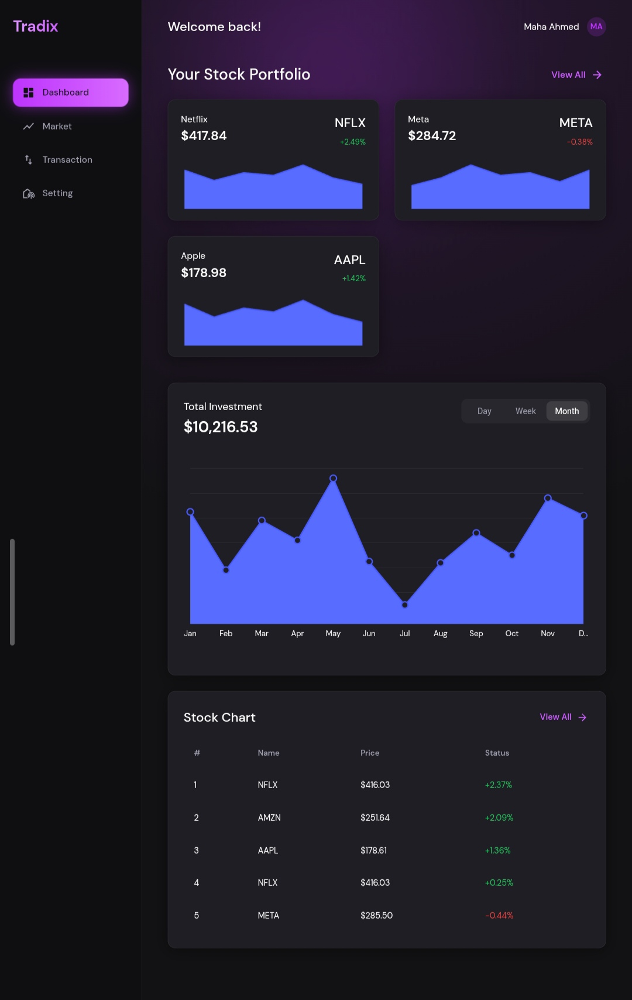

# Tradix

A dark-themed stock trading dashboard built with React, Material UI, and Redux Toolkit. It includes a portfolio overview, a live market page, a transaction history with a "new transaction" flow, and a settings page. Data comes from mock JSON files served through Axios, so the project runs without a backend and can be pointed at a real API later by changing one environment variable.

  

## Features

**Dashboard**
- Portfolio cards with price count-up animation and sparkline charts
- Total Investment area chart with Day / Week / Month range (your choice is remembered)
- Top stocks table with staggered row animations
- Live price refresh with automatic pause while the browser tab is hidden

**Market**
- Market statistics cards (market cap, volume, top gainer, top loser)
- Search, filter chips (All, Gainers, Losers, Favorites), and sortable columns
- Sparkline per stock, favorites saved in the browser

**Transaction**
- Summary cards (total bought, total sold, net position, count)
- Search, filters, sorting, and pagination
- "New Transaction" dialog with form validation and instant feedback

**Setting**
- Profile (name shows in the header with initials avatar)
- Live refresh interval, default chart range, notification preferences
- Clear cache and reset all data

**General**
- Responsive layout with a sidebar on desktop and a drawer on mobile
- Smooth animations everywhere, disabled automatically for users who prefer reduced motion
- Loading skeletons, error states with retry, and an empty state for filtered lists

## Tech stack

| Area | Choice |
| --- | --- |
| Framework | React (JavaScript, `.jsx` files) with Vite |
| UI | Material UI (`@mui/material`) and `@mui/icons-material` |
| Charts | `@mui/x-charts` v9 |
| State | Redux Toolkit (`createAsyncThunk`, `createSelector`) |
| HTTP | Axios |
| Routing | React Router (`react-router-dom`) |
| Persistence | `localStorage` (preferences, favorites, cache) |
| Font | DM Sans via `@fontsource/dm-sans` |

## Getting started

Requirements: Node.js 20 or newer and npm.

```bash
# install dependencies
npm install

# start the dev server (http://localhost:5173)
npm run dev

# lint the code
npm run lint

# create a production build in /dist
npm run build

# preview the production build locally
npm run preview
```

## Project structure

```
public/
└── mock/                  Mock API responses (JSON)
src/
├── api/                   Axios client and API functions
├── app/store.js           Redux store
├── components/
│   ├── common/            PageHeader, FilterToolbar
│   ├── layout/            DashboardLayout, Sidebar, SidebarContent, MobileDrawer, Header
│   ├── portfolio/         StockCard, StockCardSkeleton, PortfolioSection
│   ├── investment/        InvestmentChart, RangeToggle
│   ├── market/            StockTable, StocksTable, MarketStatCard
│   ├── transactions/      TransactionsTable, NewTransactionDialog
│   └── settings/          SettingsSection, SettingRow, ProfileForm, PreferencesForm,
│                          NotificationsForm, DangerZone
├── features/              Redux slices: portfolio, market, chart, stocks, transactions, settings
├── hooks/useCountUp.js    Animated number hook
├── pages/                 Dashboard, Market, Transaction, Setting, NotFound
├── routes/router.jsx      Route definitions
├── theme/                 MUI theme and shared animations
└── utils/                 localStorage helpers and formatters
```

## How data flows

```
Component → Redux thunk → API function → Axios client → /mock/*.json
```

- Components dispatch thunks from the feature slices and read state with selectors.
- Thunks call functions in `src/api`, which use the shared Axios client (`src/api/axiosClient.js`).
- By default the client reads from `/mock`. To use a real API, create a `.env` file:


- Thunks pass the abort `signal` to Axios, and components cancel requests and polling timers in `useEffect` cleanup functions to avoid memory leaks.

### Development-only behavior

- `axiosClient` adds a short artificial delay so loading states and skeletons are visible.
- `simulateLive` in `src/api/stocksApi.js` slightly changes prices on every refresh to imitate a live feed.
- `createTransaction` in `src/api/transactionsApi.js` is simulated locally because static JSON files cannot be written to. With a real API, replace it with an `axiosClient.post` call.

Remove or replace these when connecting a real backend.

## Browser storage

All keys use the `tradix:` prefix.

| Key | Purpose |
| --- | --- |
| `cache:*` | Short-lived (60 seconds) cache of API responses |
| `chartRange` | Selected range of the investment chart |
| `favorites` | Favorite stocks |
| `createdTransactions` | Transactions added by the user |
| `settings` | Profile, refresh interval, notification preferences |

Settings → Data & Storage can clear the cache or reset everything.

## Design system

| Token | Value |
| --- | --- |
| Primary | `#bd34fe` |
| Background | `#121214` |
| Card | `#1e1e24` |
| Text | `#ffffff` (primary), `#9e9eaf` (muted) |
| Positive | `#22c55e` |
| Negative | `#ef4444` |

Colors live in `src/theme/theme.js` and shared keyframes in `src/theme/animations.js`.

## Deployment notes

The app uses client-side routing, so the server must return `index.html` for unknown paths. Otherwise refreshing a page such as `/market` returns a 404.

- **Netlify:** add `/* /index.html 200` to `public/_redirects`
- **Vercel:** add a rewrite of all routes to `/index.html` in `vercel.json`

The mock JSON files in `public/mock` are included in the production build, so the demo works on any static host.
   GitHub Repository

You can explore the source code and follow the development of this project on GitHub.

"View Repository on GitHub" (https://github.com/mahaabusyam/tradix)
## Roadmap

- Connect a real market data API
- Unify the dashboard table and the Market page on a single data source
- Real notifications (needs a backend)
- Automated tests
